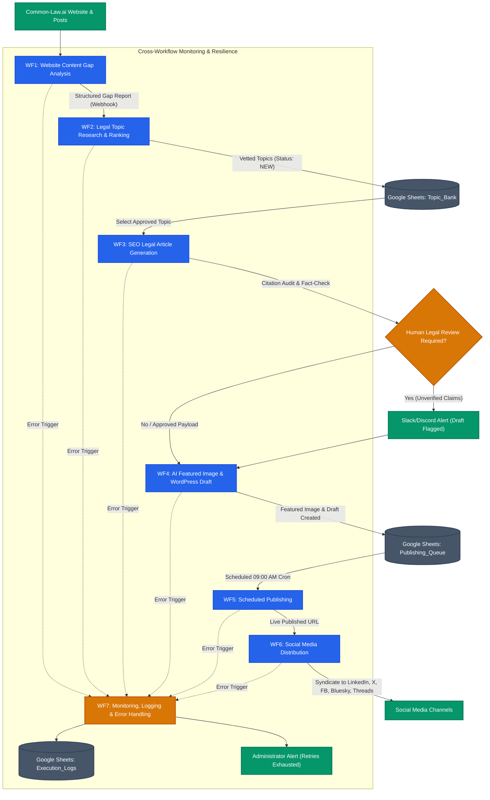
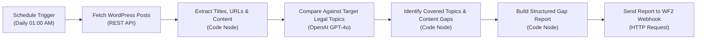
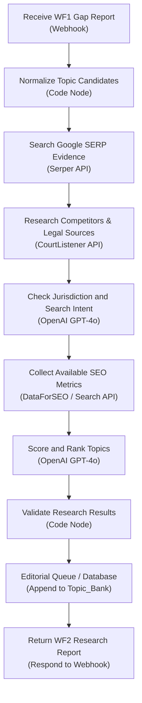
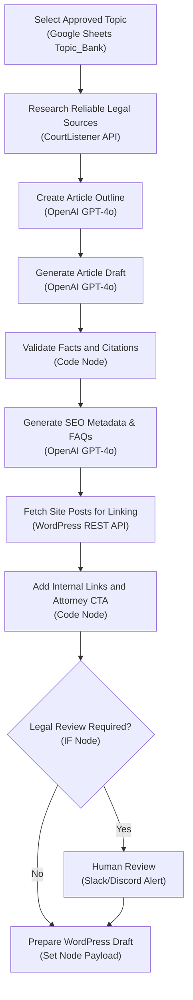
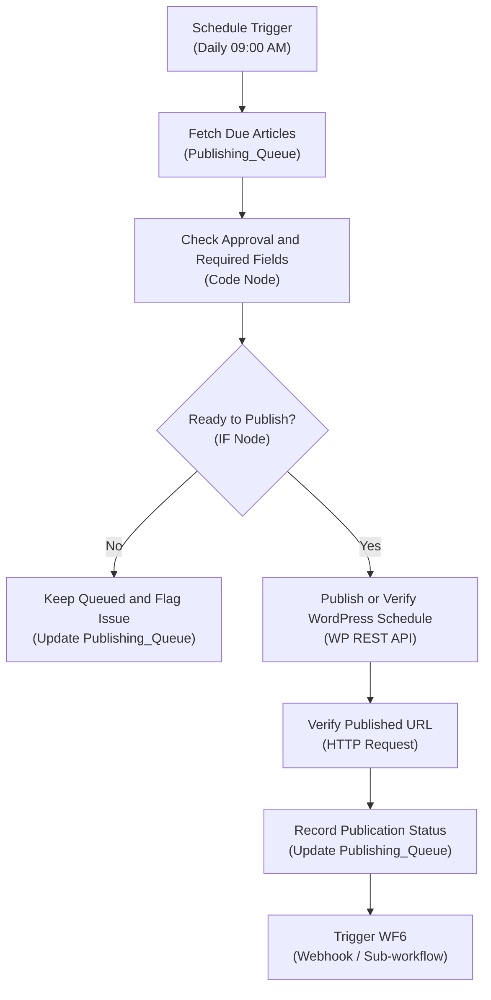
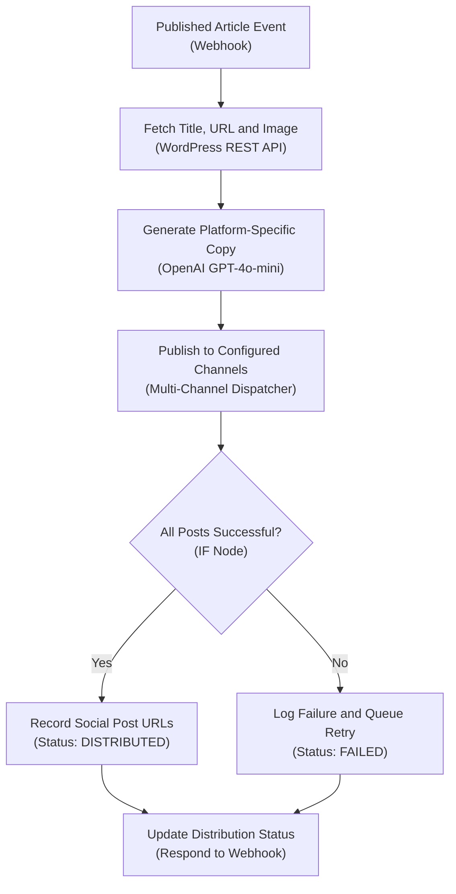
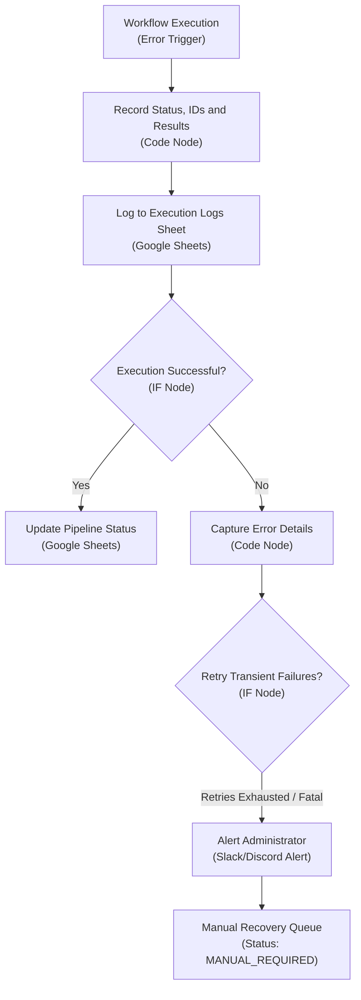

# Master Architecture & Workflow Diagrams

## 1. Master System Architecture

The Common-Law.ai legal content automation system is organized into **7 discrete, production-ready workflows**. The diagram below demonstrates how data flows from gap analysis through topic research, legal drafting, media generation, WordPress publishing, social syndication, and error monitoring.

---

## 2. Individual Workflow Diagrams (WF1 – WF7)

### WF1 — Website Content Gap Analysis
Audits live WordPress articles nightly across US States and core practice areas, determines coverage deficits, and posts a structured gap payload to WF2.

---

### WF2 — Legal Topic Research and Ranking
Consumes the WF1 report, normalizes candidates, queries Google SERP and CourtListener legal authorities, scores editorial priority (1–100), and appends vetted records to the Topic Bank.

---

### WF3 — SEO Legal Article Generation
Ingests approved topics, outlines the article, synthesizes the complete draft under strict anti-hallucination guardrails, validates citations against primary legal domains, and injects Schema.org JSON-LD and attorney directory CTAs.

---

### WF4 — AI Featured Image and WordPress Draft
Generates a photorealistic 1792×1024 editorial image via DALL-E 3 without text, uploads the binary to the WordPress Media Library, creates the post draft with Rank Math SEO custom meta, and logs the queue ID.

```mermaid
flowchart LR
    A["Approved Article Content<br/>(Trigger)"] --> B["Create Image Prompt<br/>(Code Node)"]
    B --> C["Generate Featured Image<br/>(DALL-E 3)"]
    C --> D["Validate Image<br/>(Code Node)"]
    D --> E["Download Image Binary<br/>(HTTP Request)"]
    E --> F["Upload Image to WordPress<br/>(WP REST Media)"]
    F --> G["Create WordPress Draft via REST API<br/>(Rank Math Meta)"]
    G --> H["Set Featured Image & Taxonomy<br/>(WP REST Posts)"]
    H --> I["Save Post ID and Status<br/>(Append Publishing_Queue)"]
```

---

### WF5 — Scheduled Publishing
Executes daily at 09:00 AM, verifies scheduled or due drafts, confirms required fields, promotes the post to `publish`, verifies the live HTTP 200 URL, and notifies WF6.

---

### WF6 — Social Media Distribution
Triggered when an article goes live. Generates platform-tailored social copy for LinkedIn, X (Twitter), Facebook, Bluesky, and Threads, broadcasts updates, and tracks distribution status.

---

### WF7 — Monitoring, Logging and Error Handling
Central error catcher configured as the n8n Error Trigger. Captures node and workflow error details, logs every incident to Google Sheets `Execution_Logs`, applies exponential backoff for transient issues (HTTP 429, 502, timeouts), and escalates fatal errors to Slack/Discord.

